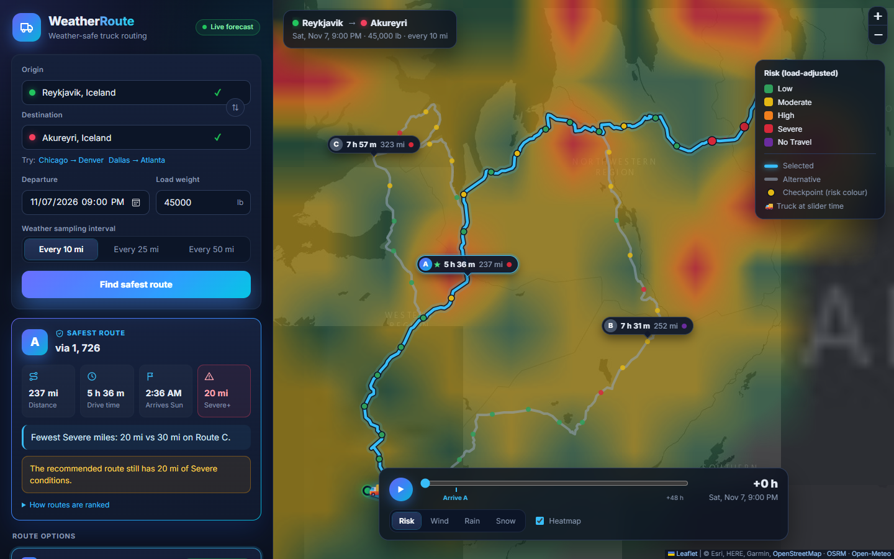

# WeatherRoute

Weather-aware truck routing. A React + Django app that helps a truck driver pick the safest route between two places, based on the weather forecast at the time the truck will actually reach each part of the route, the load weight, and travel time.

Live demo: _TBD_
Walkthrough video: _TBD_



## Features

- Origin and destination search with autocomplete (or type `lat, lon`)
- Departure date/time, load weight, and sampling interval (10, 25 or 50 miles)
- Three route options per trip
- Weather checked at every checkpoint for the truck's ETA there
- Risk per checkpoint using the wind/rain/snow table and the load rules
- Recommended route with a one-line reason (for example _"Fewest Severe miles: 0 mi vs 42 mi on Route B."_)
- Map with all routes, summary labels, colour-coded checkpoints with ETAs and conditions
- Weather heatmap over the trip corridor with a 0-48 hour forecast slider (risk, wind, rain or snow), plus a truck marker showing where the truck is at that hour

No API keys are needed. I used [OSRM](https://project-osrm.org/) for routing, [Open-Meteo](https://open-meteo.com/) for weather and [Photon](https://photon.komoot.io/) (with Nominatim as a fallback) for geocoding.

## How it works

1. **Routes.** OSRM is asked for alternatives. It often returns fewer than three, so the rest are found by routing through a point offset to either side of the fastest route. Candidates that are more than 1.6x slower, or that mostly overlap a route we already have, are dropped. When the via point makes OSRM drive up a side road and straight back, that out-and-back part is cut off.
2. **ETAs.** Segment durations come from OSRM, but OSRM uses a car profile, so every segment is capped at 65 mph for the truck (`TRUCK_MAX_SPEED_MPH`).
3. **Checkpoints.** One at the start, one every N miles, and one at the destination. Each checkpoint covers the miles halfway to its neighbours, so the miles always add up to the route length.
4. **Weather.** Hourly Open-Meteo forecast in mph and inches. Wind is interpolated between hours. Rain (rain + showers) and snowfall are hourly totals, so the value for the hour containing the ETA is used.
5. **Risk.** A checkpoint's risk is the worst of wind (after load rules), rain and snow.
6. **Recommendation.** Routes are sorted by: fewest No-Travel miles, fewest Severe miles, fewest High miles, lowest average risk, shortest time.

### Risk rules

| Condition | Low | Moderate | High | Severe | No Travel |
| --- | --- | --- | --- | --- | --- |
| Wind (mph) | < 25 | 25-34 | 35-44 | 45-54 | >= 55 |
| Rain (in/hr) | < 0.10 | 0.10-0.25 | 0.25-0.50 | 0.50-1.00 | > 1.00 |
| Snow (in/hr) | < 0.5 | 0.5-1.0 | 1.0-2.0 | 2.0-3.0 | > 3.0 |

Load rules: wind >= 55 mph is No Travel for any load, 45-54 mph with more than 30,000 lb is No Travel, and 35-44 mph with more than 40,000 lb is Severe.

### Decisions I made

- A band starts at its lower value, so 25 mph is Moderate and 0.25 in/hr is High. No Travel for rain and snow means strictly greater than the limit, so exactly 1.00 in/hr of rain is still Severe.
- Load rules need the load to be strictly over 30,000 / 40,000 lb.
- No-Travel miles are compared before Severe miles. Otherwise a route through a No-Travel area could beat one with only a bit of Severe weather.
- Weather values are shown with enough decimals (wind 1, rain 3, snow 2) that a value never looks like it belongs to a different band. 44.8 mph is High and should not be shown as "45 mph".
- If OSRM has to move the origin or destination more than 15 miles to reach a road, the trip is rejected as "no drivable route". Without this, Chicago to London quietly "worked" by starting the route in Portugal.

## Performance

- The heatmap response contains all 49 forecast hours, so moving the slider or switching layers never calls the API.
- The heatmap is a custom Leaflet canvas layer (`HeatTileLayer.ts`). It interpolates the grid and repaints the existing tiles in place when the hour changes. Each slider step took about one frame (16.7 ms) when I measured it.
- Route lines and checkpoints are memoised so they do not re-render on slider changes, and all vector layers draw on one canvas.
- Routes show up first. The heatmap loads right after, using the routes already cached on the server.
- Server-side cache: routes for 1 hour, weather for 30 minutes, geocoding for 24 hours. Weather lookups are de-duplicated on a small lattice and batched 100 locations per request. Re-planning with a different load or interval is usually instant.

## Project structure

```text
backend/
  config/                Django settings, urls, wsgi
  planner/
    services/
      risk.py            thresholds, load rules, classification
      routing.py         OSRM client, alternatives, spur trimming, truck ETAs
      weather.py         Open-Meteo client, batching, caching, sampling at ETA
      planner.py         checkpoints, summaries, ranking, explanation
      heatmap.py         corridor grid and 0-48 h frames
      geocoding.py, geo.py, http.py, errors.py
    serializers.py       request validation
    views.py, urls.py    API endpoints
    tests/               38 tests, external APIs mocked
frontend/
  src/components/        form, autocomplete, route cards, checkpoint table, slider, legend
  src/map/               map, route layers, heatmap canvas layer, hover readout
  src/lib/               risk colours, formatting, route helpers
```

## API

| Method | Path | Body / query | Returns |
| --- | --- | --- | --- |
| GET | `/api/geocode?q=Chicago` | | `{results: [{label, lat, lon}]}` |
| POST | `/api/plan` | `{origin: {lat, lon}, destination: {lat, lon}, departure, load_lb, interval_mi}` | routes, checkpoints, summaries, recommendation |
| POST | `/api/heatmap` | same as `/api/plan` | corridor grid and hourly values for hours 0-48 |
| GET | `/api/health` | | `{status: "ok"}` |

Invalid input returns 400 with field errors, an unreachable destination returns 422, and provider outages or rate limits return 503.

## Running locally

Requires Python 3.12+ and Node 20+.

```bash
cd backend
python -m venv .venv
.venv\Scripts\activate          # macOS/Linux: source .venv/bin/activate
pip install -r requirements.txt
python manage.py runserver      # http://127.0.0.1:8000

cd frontend
npm install
npm run dev                     # http://localhost:5173 (proxies /api to Django)
```

After `npm run build`, Django also serves the built frontend at <http://127.0.0.1:8000>.

### Tests

```bash
cd backend && python manage.py test planner
cd frontend && npm run typecheck
```

## Deployment

**Vercel (live demo).** The React app is served as static files and the Django API runs as a Python function (`api/index.py`). `vercel.json` handles the build and sends `/api/*` to Django.

1. Import the GitHub repo in Vercel, framework preset **Other**.
2. Deploy. On Vercel, debug mode is turned off and `*.vercel.app` is allowed automatically.

No environment variables are required. The API is stateless (no sessions, logins or signed data), so if `DJANGO_SECRET_KEY` is not set in production a random key is generated at startup.

**Docker / Render.** The same code also runs as one Docker image, where Node builds the frontend and Django + Gunicorn serve both.

- Render: New > Blueprint > pick this repo (`render.yaml`).
- Docker: `docker build -t weatherroute .` then `docker run -p 8000:8000 -e DJANGO_SECRET_KEY=change-me -e DJANGO_ALLOWED_HOSTS=your.domain weatherroute`

Optional environment variables: `OPEN_METEO_API_KEY` (higher rate limits), `OSRM_BASE_URLS` (your own OSRM server), `TRUCK_MAX_SPEED_MPH` (default 65), `DJANGO_ALLOWED_HOSTS`.

## Limitations

- The public OSRM server only has a car profile, so truck height and weight restrictions are not considered. A truck routing API (HERE, TomTom, ORS `driving-hgv`) could be dropped into `routing.py`.
- ETAs assume continuous driving, without hours-of-service breaks.
- Wind risk uses sustained wind speed as in the table. Gusts are shown for information only.
- Departures can be up to 10 days ahead. Anything past the forecast range shows as "No data".
- The free Open-Meteo tier is rate limited per server IP. Caching keeps normal use well under the limit, and `OPEN_METEO_API_KEY` can be set for heavier use.
